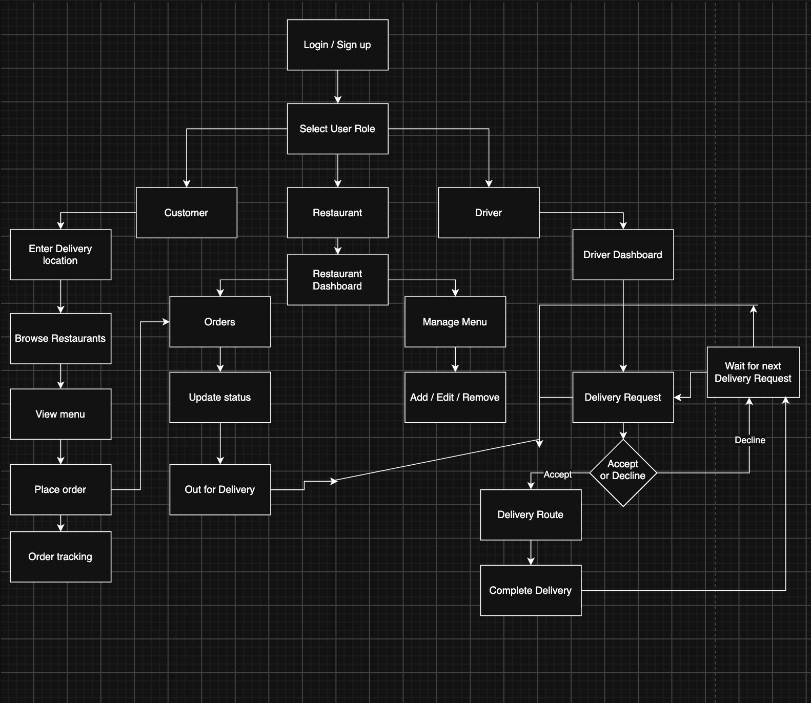

# CP317B – Software Engineering

## Milestone 02: Requirements & Backlog Expansion

**Project:** Food Delivery System  
**Group:** 6

### Team Members

| Member | Role / Responsibilities |
|---|---|
| Amir Syed | Backend – distance validation, authentication, APIs |
| Ervin Aggari | Frontend – menu/restaurant browsing, customer/restaurant dashboards |
| **Rahman Popalzai** | **Product Owner** – order placement, order processing |
| Hammad Khan | Database – restaurant accounts, menu management, messages |
| Omar Najwa | Live tracking – order tracking, delivery status, customer messages |

## 1. Requirements Refinement

The Food Delivery System needs to support restaurant owners, delivery drivers and customers. Restaurant owners should be able to communicate with customers who ordered from them and update the status of individual orders through a simple and clean interface. Delivery drivers should be able to view estimated delivery times and see the distance between their current location, the restaurant and the customer’s delivery location. These distances should help provide a more accurate estimate of how long each delivery may take. Customers should be able to browse restaurants that are available within a 35 km range of their selected delivery location, place orders through a simple interface and view the current status of their order. They should also be given an estimate of how close their order is to being delivered without being shown the driver’s exact real-time location, to help protect the privacy and safety of everyone using the application.

### 1.1 Functional Requirements

#### FR-1: Restaurant Search

The system will allow customers to enter a delivery location and display restaurants that fall within the supported 35 km delivery range.

This requires the system to use the customer's selected delivery location to determine which restaurants are eligible to deliver to them.

#### FR-2: Delivery Time Estimate

The system will provide the customer with an estimated delivery time based on the driver’s location and the customer’s delivery address. A mapping API can be used to calculate the estimated travel time and display it to the customer.

#### FR-3: Order Update

The system will allow restaurant managers to update the status of individual customer orders such as accepted, being prepared, ready or on the way. The updated status will then be shown to the customer so they can track the progress of their order.

#### FR-4: Delivery Routing

The system will provide delivery drivers with an efficient route from the restaurant to the customer’s delivery location. A mapping or routing API such as Google Maps can be used to determine the route and account for factors such as current traffic conditions or delays. Any major delays should be displayed to the driver so they can better plan the delivery.

#### FR-5: Delivery Assignment

The system will use a driver’s approximate location and availability to determine which driver is closest to a new order placed by a customer. The selected driver will get a notification saying that a delivery request is nearby, and they can choose to accept or decline it. The system should also provide an estimated travel distance or time to the restaurant and customer location.

#### FR-6: Menu Management

The system will allow restaurant managers to add, update, or remove menu items so that customers can view the restaurant’s current available offerings.

#### FR-7: View Menu

The system will allow customers to view a restaurant’s current menu so they can see available food items before placing an order.

### 1.2 Non-Functional Requirements

#### NFR-1: Performance

After a customer enters their delivery location, the system should check which restaurants are within the supported 35 km range and display the available restaurants within 10 seconds.

#### NFR-2: Privacy and Security

Customer and driver location information should be kept confidential and only shared when necessary to complete a delivery. Customers should not receive the driver’s precise real-time location, and driver location updates may be limited or delayed for safety. Drivers should also not receive unnecessary precise customer location information until it is needed to complete the delivery. This helps protect the privacy and safety of both customers and drivers.

#### NFR-3: Usability

The system should provide a simple and easy-to-use interface for customers, restaurant managers, and delivery drivers. Important features such as placing orders, updating order statuses, managing menus, and accepting delivery requests should be clearly labelled and easy to access.

#### NFR-4: Reliability

The system should reliably keep restaurant menus, order information, and delivery statuses up to date so users are shown accurate information. The system should also avoid losing order or status information while an order is being processed.

## 2. Updated Ethical Considerations

### Privacy

The system should keep all users’ personal information private and avoid storing information longer than necessary after an order has been completed. To help protect both customers and drivers during a delivery, the customer should not receive constantly updated precise driver locations. Drivers should also only receive the customer location information that is necessary to complete the delivery. Messages between customers, restaurant staff and drivers should remain monitored so that authorized administrators can intervene if inappropriate or unsafe behaviour occurs.

### Security

The system should protect user information, such as account information, order information, and payment-related data, from unauthorized access. Payment information should be handled through a secure third-party payment service instead of storing complete card details directly in the system. Access to restaurant, customer, and driver information should also be limited based on the user's role in the app so that users can only access the information they need.

### Fairness

The system should treat customers, restaurant owners and delivery drivers fairly. Delivery drivers should be able to accept or decline delivery requests instead of being forced to take an order based only on their location. Restaurant and delivery information should also be shown using consistent rules so that users are not unfairly prioritized or excluded without a valid reason.

### Accessibility

The system should be designed so that customers, restaurant owners and delivery drivers can use it as easily as possible. Text and buttons should be clear and easy to read, and the interface should use good contrast between text and backgrounds. Important actions should be clearly labelled and information such as order status should not rely only on colour. The layout should as well be simple and consistent so all users can navigate and understand it quickly without any difficulty.

## 3. Initial Design Sketches

The following design sketches show the basic navigation and interface layout for customers, restaurant owners and delivery drivers.

### Navigation Flow Diagram



### Customer Restaurant Screen

```text
┌──────────────────────────┐
│ Customer Restaurant      │
│                          │
│ Delivery Location        │
│ [____________________]   │
│                          │
│ Restaurant A [View Menu] │
│ Restaurant B [View Menu] │
└──────────────────────────┘
```

### Driver Request Screen

```text
┌──────────────────────────┐
│ Driver Request           │
│                          │
│ Restaurant: 3.2 km       │
│ Customer: 7.1 km         │
│ ETA: 24 min              │
│                          │
│ [Accept]     [Decline]   │
└──────────────────────────┘
```
